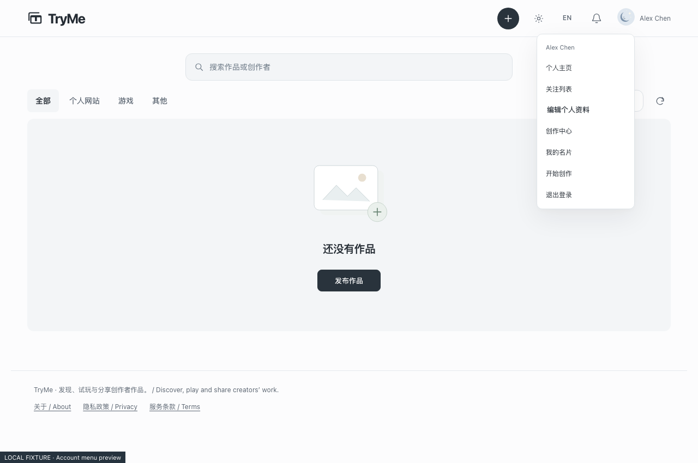
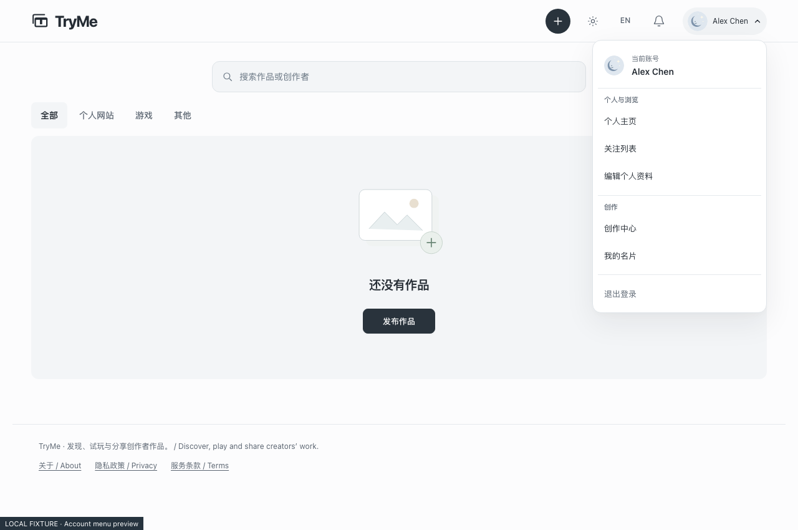

# 账号菜单层级与焦点修复 · 2026-11-20

基于 `origin/main` 的 `ae684982`；分支 `fix/account-menu-hierarchy-2026-11-20`。仅修改账号菜单、必要的页头联动及验证文件。未改 studio/cards 内容页，未部署到 production/staging。

## 行为

- 身份区显示头像、当前账号与完整姓名；页头姓名和头像共同作为开关，长姓名在页头省略、在菜单内换行。
- “个人与浏览”：个人主页、关注列表、编辑个人资料；“创作”：创作中心、我的名片；退出登录单独分隔。
- 所有菜单链接和按钮使用相同字重、字号、内边距和至少 44px 点击高度。“编辑个人资料”不再额外加粗。
- 移除含糊的“开始创作”。`creatorReady` 为 false 或状态未知时显示“创作入门”，进入原有可跳过的 `/welcome`；已有创作状态的账号隐藏此重复引导。页头“＋”仍提供上传作品和制作名片，所有账号均可使用，没有角色或设备限制。
- 沿用 `mountMenus()` 的原生 disclosure、Tab 顺序、Escape、外部点击与移出焦点关闭。移除重复的账号菜单 click 监听。同账号更新资料或语言时保留开关节点，保证资料弹窗取消或保存后都能返回可见开关。
- 窄屏隐藏页头姓名及箭头；菜单限制宽高，短横屏可在内部滚动到退出操作。采用现有浅深色语义色和清晰焦点样式。

## 前后截图

截图使用真实 `site.html` / `site.js` 与合成账号 `Alex Chen`。基线来自 `ae684982`，背景为空 Feed；不是用户线上账号或真实后端验收。

| 基线 | 调整后 |
| --- | --- |
|  |  |

[英文深色、窄屏与长姓名](assets/account-menu-2026-11-20/after-mobile-dark-long.png) · [短横屏滚动至退出](assets/account-menu-2026-11-20/after-landscape-scroll.png)

## 检查与范围

- `npm test`：700 项通过；导航合同测试覆盖新／已有创作状态和安全姓名输出。
- `npm run check`：应用脚本与 TypeScript 检查通过。
- `npm run build:standalone`：通过，无部署；构建仍输出现有 Vinext 动态导入／分包提示。
- Chromium `159.0.8154.6`，Playwright `1.65.1`：1280、768、390、320px × 中英文 × 浅深色，共 16 组长姓名布局检查通过。检查菜单边界、页头边界、统一字体与 44px 项目高度。
- 浏览器检查：Enter/Space 开关、完整 Tab 顺序、移出焦点、Escape 返回开关、外部点击关闭、外观菜单互斥、资料取消／保存后的焦点、四个导航入口、退出后的游客状态；原有可选引导可以无写入返回 Feed，“＋”仍可进入新创作资料步骤。
- 667×320 短横屏中，键盘可滚动至退出项，菜单保持打开。没有浏览器脚本异常。
- 已知范围外问题：320px 英文 Feed 筛选栏使页面宽度达到约 329px，`ae684982` 基线同样可复现。账号菜单与页头没有越界。
- 未验证真实 Clerk 登录／退出、生产 API、实体手机、Safari/微信或屏幕阅读器。以上浏览器结果均为本地 fixture。

## 本地预览与复现

在此分支工作区运行（默认仅绑定 `127.0.0.1:8898`，端口冲突时会失败，不会占用其他进程）：

```sh
node tests/integration/account-menu-preview.mjs 8898
```

访问 `http://127.0.0.1:8898/`，选择已有账号、新账号、长姓名、深色英文或游客。fixture 只提供菜单相关的合成数据；资料保存仅更新本进程内存，退出仅切换为合成游客，没有连接真实账号或生产后端。

可选浏览器回归（单独安装工具，不改应用依赖；预览进程须保持运行）：

```sh
npm install --prefix .preview --no-save playwright@1.65.1
./.preview/node_modules/.bin/playwright install chromium
node tests/integration/account-menu-browser.mjs
```

回归报告和新截图写入 `.preview/account-menu/`。文档中的基线与完成截图保存在 `docs/assets/account-menu-2026-11-20/`。
