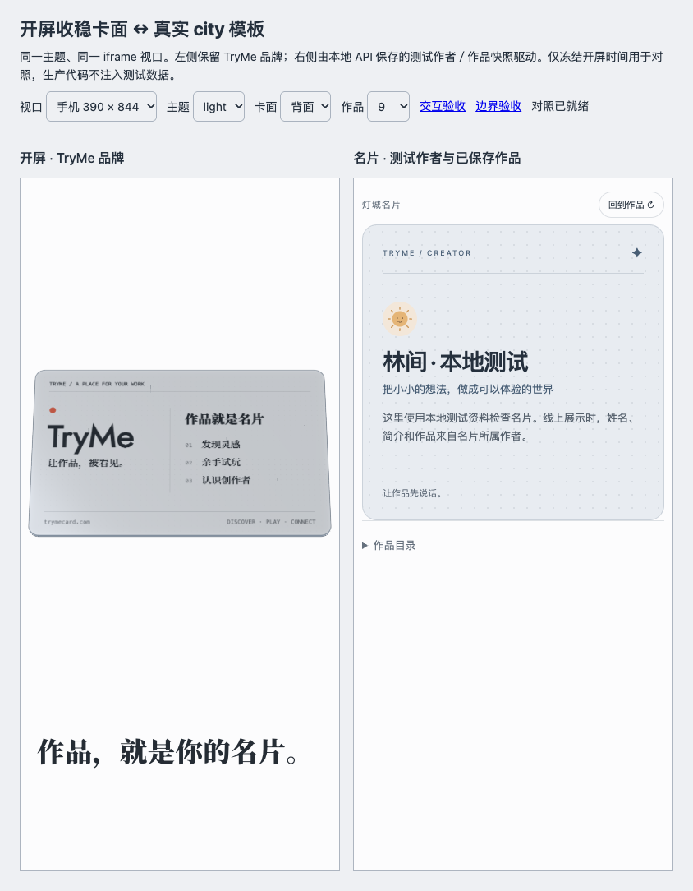

# 开屏与灯城名片一致性核对 · 2026-11-20

基线 `ae684982`；独立工作区 `funtrack-city-consistency-2026-11-20`，分支 `fix/city-opening-consistency-2026-11-20`。本次交付本地视觉修正、浏览器证据和文档更正，尚未部署，交由后续统一集成。

## 已上线版本的事实更正

- `a8b01db` 是 `838b149`（11.19 应用发布提交）及 `ae684982` 的祖先。`git diff d72764e ae684982 -- public/lit-city` 为空，旧 settled-city 改版已完整进入主线，无需再次 cherry-pick。
- 2026-11-20 15:04 EST 匿名 GET 生产 `/site.js`、`/lit-city/{controller,theme,scene,config}.js`、`/opening/theme.js`、`/opening/card/config.js` 均为 200，与修正前 `ae684982` 文件逐字节一致。[SHA-256 记录](evidence/city-consistency-2026-11-20/production-assets.json)。这证明所读资源的上线状态，不等于对生产账号、真机或全部资源的验收。
- 已更正 `project-status-2026-11-19.md`、`settled-city-card-2026-11-18.md`、`release-29-30-34-2026-11-19.md` 中“本地、未上线”的错误；保留原发布版本和历史验收范围。

## 对照结论与修改

两侧使用同主题、同尺寸 iframe：桌面 960 × 700、手机宽度 390 × 844（尺寸包含边框）。开屏停在实际时间线的收稳正面／完成背面；真实 city 模板从本地真实保存及公开读取 API 接收作者资料、作品 ID、版本和封面。测试身份与存储由 fixture 提供，未读写线上业务数据。

| 项目 | 判断与结果 |
| --- | --- |
| 正面材质、刻线、照明 | 浅色原本一致。最终两侧实际执行配置与主题模块后，`COL`、`LINE`、`LIGHT`、`POST` 全部一致；日夜往返没有累积 shader patch。[参数核对](evidence/city-consistency-2026-11-20/material-parity.json) |
| 深色光晕 | 开屏原为 0.40、名片为 0.18；统一为 0.18。保留名片对浅底作品封面的细节，不增大真实作品曝光；日间仍为 0。生产改动在 `opening/card/config.js`，灯城配置只补说明 |
| 背面纸色与纹理 | 默认深色纸统一为 `#10151b`、浅色纸为 `#e8ecf1`。名片原来的斜线装饰改为轻点阵和上下细分隔线，呼应开屏的印刷街道网格。作者选的 ivory／cobalt 保留 |
| 构图与镜头 | 保留场景差异：开屏桌面右侧卡片为左侧品牌标题留位；真实名片居中放大，让作品更易选择。两侧收稳角度一致，桌面 1.02、手机 1.12 弧度。真实名片可展开／重播，开屏按自己的完整时间线演示 |
| 正背面与翻面 | 开屏继续使用 TryMe 固定品牌纹理和完整 3D 翻面；真实名片继续用可换行、可选择、链接可点击的 HTML 作者背面及轻量翻面过渡，容纳长资料及无 WebGL 状态。保留原交互，没有替换作者资料或作品快照 |
| 分辨率与景深 | 保留实时名片的像素倍率上限与清晰作品显示，以及开屏的质量调节和景深。未为像素级相同而增加移动端 GPU 负担 |

## 清晰对比

每张图左侧为开屏、右侧为真实 city 模板；左右作品本来不同，不以封面颜色或亮度相同作为一致性条件。

| 视图 | 修改前 | 修改后 |
| --- | --- | --- |
| 桌面浅色正面 | [before](evidence/city-consistency-2026-11-20/before-desktop-light-front.png) | [after](evidence/city-consistency-2026-11-20/after-desktop-light-front.png) |
| 桌面深色正面 | [before](evidence/city-consistency-2026-11-20/before-desktop-dark-front.png) | [after](evidence/city-consistency-2026-11-20/after-desktop-dark-front.png) |
| 桌面浅色背面 | [before](evidence/city-consistency-2026-11-20/before-desktop-light-back.png) | [after](evidence/city-consistency-2026-11-20/after-desktop-light-back.png) |
| 桌面深色背面 | [before](evidence/city-consistency-2026-11-20/before-desktop-dark-back.png) | [after](evidence/city-consistency-2026-11-20/after-desktop-dark-back.png) |
| 手机浅色正面 | [before](evidence/city-consistency-2026-11-20/before-mobile-light-front.png) | [after](evidence/city-consistency-2026-11-20/after-mobile-light-front.png) |
| 手机深色正面 | [before](evidence/city-consistency-2026-11-20/before-mobile-dark-front.png) | [after](evidence/city-consistency-2026-11-20/after-mobile-dark-front.png) |
| 手机浅色背面 | [before](evidence/city-consistency-2026-11-20/before-mobile-light-back.png) | [after](evidence/city-consistency-2026-11-20/after-mobile-light-back.png) |
| 手机深色背面 | [before](evidence/city-consistency-2026-11-20/before-mobile-dark-back.png) | [after](evidence/city-consistency-2026-11-20/after-mobile-dark-back.png) |

## 验证与限制

- `npm run check` 通过；`npm test` 700/700 通过。最终开屏光晕调整后再次执行 check、开屏与灯城 17/17 测试及 `npm run build:standalone`，全部通过。构建只有 vinext 现有的静态／动态 import 重复警告，没有部署。
- Chrome 157.0.8103.79：以上 8 组同视口正背面／日夜截图；另以 390 × 844、DPR 2、触控模拟执行[浏览器检查](evidence/city-consistency-2026-11-20/browser-checks.json)，13 项场景通过、0 个 page error。
- 1／3／6／9／10／30 件已保存作品；第二页展开后日夜往返、背面日夜往返，当前页／正背面／展开状态保留。[换主题后仍展开](evidence/city-consistency-2026-11-20/mobile-expanded-after-theme.png)。收回、播放、跳过与键盘 End/Enter 正常；第 30 件在公开名片弹出 v1 详情及正确的登录回跳链接。[作品详情](evidence/city-consistency-2026-11-20/work-30-public-dialog.png)。本次未执行真实登录或生产试玩。
- [空作品](evidence/city-consistency-2026-11-20/edge-empty.png)、[封面缺失／失败](evidence/city-consistency-2026-11-20/edge-missing.png)、[长文本背面](evidence/city-consistency-2026-11-20/edge-long.png)、[减少动态效果下展开城市](evidence/city-consistency-2026-11-20/edge-reduce.png)、[WebGL 不可用](evidence/city-consistency-2026-11-20/edge-webgl.png) 通过。WebGL 降级后目录仍可发出选中作品事件。另核对 [ivory](evidence/city-consistency-2026-11-20/back-ivory.png)／[cobalt](evidence/city-consistency-2026-11-20/back-cobalt.png) 作者配色。
- macOS Safari 26.5：WebDriver 因未启用远程自动化不能运行；未修改浏览器设置。改用实际 Safari 窗口检查 390px 两侧浅色正面、展开城市、点击翻到作者背面及两侧深色背面，均显示正常，作者文字完整。证据为本次界面工具截图／可访问性树；仓库里的 PNG 为 Chrome 截图，不能标为 Safari 截图。
- 手机宽度是浏览器视口，未验证实体 iPhone、iOS Safari、微信内置浏览器或低端 Android 性能。开屏对照冻结时间仅用于截图，不等于本轮重新全程验收开屏动画。

## 复查方式

在本工作区启动 `CITY_PREVIEW_PORT=18821 node diagnostics/settled-city-preview.mjs`：

- [开屏／名片并排](http://127.0.0.1:18821/__city/compare?size=mobile&theme=light&face=back)
- [保存名片与交互](http://127.0.0.1:18821/__city)
- [边界场景](http://127.0.0.1:18821/__city/edge)

可选脚本：`PLAYWRIGHT_MODULE=/absolute/path/to/playwright/index.mjs node diagnostics/city-consistency-browser.mjs`，需要已安装 Chrome。可用 `CITY_PREVIEW_ORIGIN` 指定其他 loopback 端口。诊断依赖不加入运行时依赖，所有测试资料与故障注入只存在于 diagnostics。未修改旧 8791 lab、公开分享流程、菜单或其他 session 文件。
