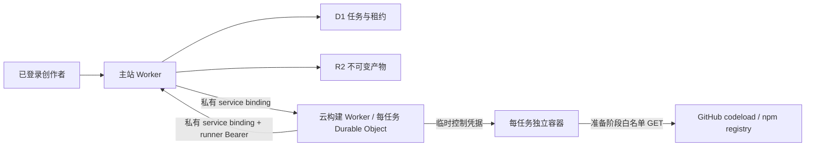

# Cloudflare 云构建器部署与验收（2026-11-16）

本文说明如何把 Funtrack 的公开 GitHub 仓库构建移到云端。范围是独立测试站 `funtrack-staging`，不是原 Sites 站点，也不改变作品、名片、登录或 D1/R2 数据结构。

**已部署到独立 staging，并通过真实仓库端到端验收。** 用户亲自开通 Workers Paid 后，部署私有构建服务并接通主站；本机 runner 全部停止时，完成真实 Snake 仓库的导入、构建、预览、发布和全屏试玩。日期按 America/New_York 记录，云端日志为 2026-11-17 UTC。具体证据和未覆盖范围见文末。

## 运行结构



主站先保存 `queued` 任务，再发送任务 ID。构建器通过受认证的回调领取固定 SHA 和租约，最后把 HTML 回传给主站；主站校验、计算哈希并写入 R2。构建完成只产生可发布产物，**不会自动发布或替换作品版本**。

| 组件 | 当前配置 | 职责 |
| --- | --- | --- |
| 主站 | `wrangler.standalone.staging.jsonc`，Worker `funtrack-staging` | Clerk 身份、所有者权限、任务限额、D1/R2、作品发布 |
| 云构建器 | `cloud-builder/wrangler.jsonc`，Worker `funtrack-builder-staging` | 私有调度、每任务 Durable Object、容器生命周期 |
| 主站 → 构建器 | `FUNTRACK_CLOUD_BUILDER` | 查询能力、提交任务 ID、通知取消 |
| 构建器 → 主站 | `FUNTRACK_SITE`，`FUNTRACK_SITE_ORIGIN` | 专用 runner 协议，带共享 runner secret |
| 容器 | `cloud-builder/Dockerfile`、`cloud-builder/runner/` | 下载、安装、离线构建和单文件封装 |

构建器配置 `workers_dev: false`、`preview_urls: false`，没有公开 route。不要为它添加公开域名或 workers.dev 入口；`/jobs` 的入口隔离依赖私有 service binding。主站保留现有 Clerk 认证，`/api/build-worker/*` 只接受专用 Bearer，不接受用户或伪造身份头代替 runner 凭据。

## 支持范围与限制

公开仓库支持两条路径：非 Vite 仓库已有独立 `dist/index.html`（没有时使用根 `index.html`），则校验后直接导入，不安装依赖或执行项目脚本，不要求另补根 LICENSE；已有声明保留。识别为 Vite 源码项目时仍走构建，不用旧 dist 覆盖新源码。

**Vite 静态前端项目**：仓库根目录含 `package.json`、`build` 脚本、npm v2/v3 格式的 `package-lock.json` 和有效 `LICENSE`。依赖必须满足现有 registry 与完整性校验；不支持私有依赖、工作区、多服务仓库或后端服务。需要联网运行、依赖安装生命周期脚本或不能封装成独立 HTML 的项目可能失败，应在本地处理后上传成品。

| 限制 | 当前值 |
| --- | --- |
| 单个最终 HTML | 最大 16 MiB，含来源声明与内联资源；超过 8 MiB 非阻断提示 |
| 仓库压缩包 / 解包后总量 | 64 MiB / 256 MiB |
| 仓库内单文件 | 32 MiB |
| 仓库文件数 | 最多 5,000 |
| 单个作者的活动任务 | 最多 2 个，排队也计入 |
| 单个作者新建任务 | 每小时最多 10 个；同幂等键重放不新增任务 |
| 全站有效执行租约 | 最多 2 个，D1 原子领取限制 |
| Cloudflare 容器 | `standard-1`，`max_instances: 2` |
| 单次执行总时限 | 8 分钟；启动与容器内流程有各自超时保护 |
| 任务租约 / 排队超时 | 各 10 分钟 |
| 恢复调度 | 每分钟 Cron；等待执行槽位时 DO 约每 10 秒重试 |

两个执行租约和两个容器是不同层面的上限；销毁中的旧容器仍可能暂时占用平台容量。不要把 `max_instances` 当作已经完成的费用估算。运行成本应依据真实容器时长、实例规格、出网和存储账单另行核算。

本地 HTML、GitHub 单文件 HTML 直读及已有网站链接不依赖云构建器。完整 40 位 SHA 的 blob/raw HTML 链接直接读取固定 raw 文件，分支或标签仍需解析并固定提交。

## 隔离设计

容器使用原生 `ctx.container` API，**保持默认 scheduling policy**。当前配置没有指定 `scheduling_policy`；不要改成 `durable_object` policy。现有设计依赖默认策略下的用户与文件权限：可信控制服务为 root，仓库命令降为 UID/GID 1000、清空补充组和 capabilities，并启用 `no-new-privs`。工具与控制文件不可由构建用户写入，构建前会检查这些边界；失败应返回 `ISOLATION_FAILED`，不能跳过检查继续运行。

执行分为两阶段：

1. **准备。** `enableInternet: false`，仅由可信 DO 为 `codeload.github.com` 与 `registry.npmjs.org` 安装 HTTP/HTTPS 出站拦截。允许 GET，统一转为 HTTPS，不转发 Authorization、Cookie 或用户请求头，不跟随重定向。下载固定 SHA，验证归档、项目与锁文件，再执行 `npm ci --ignore-scripts`。
2. **构建与封装。** DO 将上述两个域名的 HTTP/HTTPS 拦截全部替换为拒绝处理器，再调用 `/build`。容器检查网络已拒绝、进程权限符合要求后，才执行项目 `build` 与固定工具链封装。每个命令结束会清理构建 UID 的残余进程；成功、失败、取消和超时都应销毁容器。

Cloudflare、Clerk、Sites、GitHub 凭据以及平台的 `FUNTRACK_BUILD_RUNNER_TOKEN` **均不传入容器**。每个任务会产生一个独立随机控制 token，仅供可信 DO 调用容器内控制服务；它不是平台 runner token，仓库子进程使用单独构造的环境，不继承该 token。控制服务启动后也会从自身 JavaScript 环境对象删除该变量。实际云平台下的 UID、`/proc`、文件权限和出网行为仍须远端验收，不能只凭配置推断安全边界已经生效。

## 部署前准备

以下命令均在仓库根目录运行。确认 Cloudflare 账号有 Workers Paid、Containers 与 Durable Objects 的可用权限；确认目标仍是测试环境。主站现有 D1/R2 与 Clerk secret 继续沿用，不要重新创建数据库或修改登录配置。

云构建器单独锁定 **Wrangler 4.163.0**，位于 `cloud-builder/package.json` / `package-lock.json`。主站原有依赖仍归根目录管理；不要为了部署容器直接升级根目录 Wrangler、Vite 或 Sites 工具链。

```sh
npm --prefix cloud-builder ci
node cloud-builder/node_modules/wrangler/bin/wrangler.js --version
node --test tests/cloud-build-service.test.mjs tests/build-rules.test.mjs tests/cloud-builder.test.mjs cloud-builder/tests/runner.test.mjs
npm run check
node cloud-builder/node_modules/wrangler/bin/wrangler.js deploy --dry-run --config cloud-builder/wrangler.jsonc
```

可选的本地 Docker 集成需要 Docker 正常运行。它会下载公开源码与 npm 依赖，但不使用 Cloudflare 凭据、不写云资源：

```sh
docker build -f cloud-builder/Dockerfile -t funtrack-cloud-builder:local-check .
node cloud-builder/tests/local-runner.mjs
```

本地报告位于 `.preview/cloud-builder/local-runner-test.json`，其中 `provider` 应为 `local-docker-only`。它验证本地容器边界和真实 Snake 构建，**不证明 Cloudflare 出站拦截或云容器已通过**。镜像构建上下文受 `cloud-builder/Dockerfile.dockerignore` 白名单约束，不应带入 `.dev.vars`、主站源码目录、凭据、本地依赖或 Sites 文件。

## 发布顺序与共享 secret

下面的发布与 secret 命令会修改远端，仅由部署负责人在确认账号、目标环境和运行中任务后执行。首次接入先创建/部署私有构建 Worker，使主站的 service binding 有实际目标。尚未配置 secret 或主站尚未更新时，能力查询失败和恢复 Cron 暂时失败都不代表验收通过。

```sh
node cloud-builder/node_modules/wrangler/bin/wrangler.js deploy --config cloud-builder/wrangler.jsonc
```

两端需要**同一个** `FUNTRACK_BUILD_RUNNER_TOKEN`。不要把值写进 JSONC、命令行参数、仓库、文档或构建日志。以下示例只在 Node 进程内生成随机值，再通过 stdin 分别传给两次 `secret put`；它会轮换两端 secret，因此不要在旧 runner 或活动构建仍使用旧值时执行。已有正确同值配置无需重复轮换。

```sh
node --input-type=module <<'NODE'
import { randomBytes } from 'node:crypto';
import { spawnSync } from 'node:child_process';
import { resolve } from 'node:path';
const cli = resolve('cloud-builder/node_modules/wrangler/bin/wrangler.js');
const token = randomBytes(32).toString('hex');
for (const config of ['cloud-builder/wrangler.jsonc', 'wrangler.standalone.staging.jsonc']) {
  const result = spawnSync(process.execPath, [cli, 'secret', 'put', 'FUNTRACK_BUILD_RUNNER_TOKEN', '--config', resolve(config)], {
    input: token + '\n', stdio: ['pipe', 'inherit', 'inherit'],
  });
  if (result.error || result.status !== 0) throw new Error('Secret update incomplete; do not enable builds until both sides match.');
}
NODE
```

如果第二次写入失败，两端可能不一致；不要靠输出 secret 排查。恢复两次写入并确认调用成功后再开放构建。首次构建器部署会应用其自身 DO `v1` migration，**不是主站 D1 数据迁移**。

接着构建并发布主站的 standalone 测试配置。源码配置必须含 `FUNTRACK_BUILD_MODE: "cloud"` 和指向 `funtrack-builder-staging` 的 `FUNTRACK_CLOUD_BUILDER`。检查编译结果也保留这些绑定，部署时只指定 standalone 产物，避免误发布 Sites 产物：

```sh
node scripts/standalone.mjs build --config wrangler.standalone.staging.jsonc
node scripts/standalone-deploy.mjs --mode staging
node cloud-builder/node_modules/wrangler/bin/wrangler.js deploy --dry-run --config dist-standalone/server/wrangler.json
node cloud-builder/node_modules/wrangler/bin/wrangler.js deploy --config dist-standalone/server/wrangler.json
```

离线 preflight 不验证远端 secret、容器运行或账号权限。当前测试站仍使用明确标识的 Clerk 测试配置，不因此成为已完成生产认证验收的正式站点。

## 调度、重试与取消

| 接口 | 调用方与用途 |
| --- | --- |
| `GET /api/builds/capabilities` / `availability` | 已登录用户只读查询；云模式探测私有构建服务，`mode: "cloud"`，心跳字段为 `null` |
| 私有 `POST /jobs`，`{buildId}` | 主站提交任务 ID；DO 持久化后回 `202 {accepted:true}` |
| `POST /api/build-worker/claim`，`{workerId,buildId}` | 云构建器带专用 Bearer 定向领取；云模式拒绝缺少 buildId 的旧通用领取 |
| `POST /api/build-worker/:id/status`，`{workerId,leaseId}` | 检查租约身份及取消/失败/完成状态 |
| `POST /api/build-worker/:id/progress`、`fail`、`complete` | 沿用既有阶段与产物回传协议；过期或已取消租约不能完成 |
| `POST /api/build-worker/queued` | 可信 Cron 查询最多 20 个尚在排队的任务 ID，恢复遗漏调度 |
| `POST /api/builds/:id/cancel` | 所有者先在 D1 取消，再通知私有 `/jobs/:id/cancel` 销毁容器 |

D1 是任务状态的依据。创建任务后调度请求失败，不删除已提交任务；同键重放、所有者查询 queued 任务以及每分钟 Cron 都能重发提交。DO 按任务 ID 保存状态，重复入队不应重复启动执行。

同一 worker 对同一任务重复 claim 会得到原有效租约，不延长租约；执行槽位满时保持 queued 并稍后重试。DO 执行中断后不会重新运行未知进度的项目代码，而是报告失败或等待租约超时；用户用新的导入操作重试。完成回传允许同租约、同产物和同元数据重放，已 ready 的产物不可覆盖。取消与完成竞争由 D1 条件更新裁决，取消先成功时，上传中的无引用 R2 产物会被清理。

云模式不需要本机常驻 `scripts/build-runner.mjs`。若回退本地模式，必须显式把 `FUNTRACK_BUILD_MODE` 改为 `local` 或移除，并重新配置、启动兼容 runner；本地模式仍要求 90 秒内心跳。先等活动任务结束或取消，避免切换期间争抢租约。

## 运维检查

查看两个 Worker 的日志；命令会持续读取，完成后按 Ctrl-C 停止。不要收集或转发登录 cookie、Bearer 或带凭据的 URL：

```sh
node cloud-builder/node_modules/wrangler/bin/wrangler.js tail --config cloud-builder/wrangler.jsonc
node cloud-builder/node_modules/wrangler/bin/wrangler.js tail --config wrangler.standalone.staging.jsonc
```

能力显示 online 只表示绑定服务配置就绪，不能证明镜像已经成功启动或当前有空闲执行槽位。实际构建错误要结合任务 `errorCode` 与阶段日志判断：

- `BUILD_RUNNER_UNCONFIGURED` / `BUILD_RUNNER_OFFLINE`：核对 mode、两侧 binding、secret 是否同时配置及构建服务可达性。
- `BUILD_TARGET_REQUIRED`：云模式收到旧本机 runner 的通用领取，应停止旧 runner。
- `BUILD_QUEUE_TIMEOUT` / `BUILD_TIMEOUT`：检查槽位、DO alarm、镜像启动和阶段耗时；失败任务不原地复活。
- `UNSUPPORTED_PROJECT` / `UNSUPPORTED_LOCKFILE` / `LICENSE_REQUIRED`：修正项目格式，或本地打包后上传。
- `ISOLATION_FAILED`：停止该次构建，核实 scheduling policy、出网拦截和 UID 权限；不要删除检查规避失败。

## 远端验收记录

验收约为 2026-11-17 03:34–03:40 UTC。真实 Chrome 使用已登录的创作者账号，无测试身份替换。仅新增 1 件明确标记的测试作品；取消和超限任务没有生成作品。

| 项目 | 实际记录 |
| --- | --- |
| Cloudflare 账号 / 环境 | `26ecbb83a9773e88121606953aeca69f`，独立 staging；既有 D1/R2，无新 D1 迁移 |
| 构建 Worker 版本 | `acee7f27-3a91-410e-90ec-50f0186641c1`（含 secret 配置） |
| 容器应用 / 镜像 | `a0361c0e-b60d-4ad7-a8c3-4b9185fe96e5`；镜像 SHA-256 `9e1da651c5cb99e05e5e1dedfa3315b9f3b59409325879d2f59c40b82fbcb2df`；远端 `scheduling_policy=default` |
| 主站 Worker 版本 | `66384f74-8f5b-4b49-9669-272102e76f96` |
| 私有入口 / 不依赖本机 | 配置与部署无公开 route、workers.dev 或 preview；仅 service binding。现场无本机 build runner 或测试构建容器；云端记录位于 `ord11`，任务结束后 inactive |
| 成功任务 | `f0ca9ea8-79e9-4c44-a919-2c3d32930a76`；Snake 固定 SHA `1f76427453c48f6f0a02d09a12e0469451c0d1e3` |
| 产物 | 229,573 bytes；SHA-256 `47c025db71bd8c6aea689e2427a82b7f8351df6059ff295887c93b696528e48b`；R2 构建文件与发布文件分别读取核验一致 |
| 云端出网验证 | 准备阶段允许下载；执行前 npm / codeload 两个精确域名探针均收到 403 + `X-Funtrack-Egress: denied`，记录 `cloudflare-deny` |
| 云端权限验证 | UID/GID 1000、CapEff=0、noNewPrivileges=true；构建进程无控制 token、不能读 root proc、不能写控制代码或 toolkit |
| 发布与试玩 | 作品 `f76d712f-9eb8-4ba8-986f-4ce01aea58bc`，v1 `c7e51f59-1ba1-4653-9b6e-7221bd4d3035`；预览启动、正式 iframe 启动、全屏和退出通过；work_view/play_start/session_end 绑定 v1，活跃时长 4057ms |
| 运行中取消 | 任务 `3c67d90d-00e7-46aa-bde2-f7fa9e225bf0` 在 installing 取消；页面已取消、D1 cancelled、无 artifact、容器 inactive。迟到完成的拒绝另外由后端测试覆盖 |
| 超限失败 | `4804a3b2-e2c5-4dea-bb67-0e117f2086f8`：rain-between-rooms 固定 SHA `0f15da7b9965af440a4e7bac348d30834c5667cf` 源码压缩包超过 16 MiB，`ARCHIVE_TOO_LARGE`，无 artifact、容器 inactive；页面提示本地打包 ≤8 MiB HTML |
| 旧数据 | 旧 5 件作品、6 个版本、1 张完整名片快照、22 条事件，在基线字段范围内逐行一致；当前版本引用无悬空 |
| 本地与自动检查 | 主测试 213/213、执行层 6/6；类型/脚本检查、独立站构建及预检、容器 dry-run、真实本地双阶段断网构建通过 |
| 实际构建阶段时长 | 总计 62,874ms；下载 336、安装 22,034、build 21,620、封装 18,372。未把阶段耗时当完整计费时长；尚无账单或单次费用结论 |

未做真实远端的三任务并发压力、刻意丢失调度、强制 DO 重启/超时测试；这些状态分支由自动测试覆盖，不能称为云端故障注入验收。此次未重新提交本地 HTML/HTML 直读/外链路径，也未重测完整数据面板；它们的前一轮记录保留在上传验收文档。真实云隔离探针是定向证据，不是穷举安全测试。

原始证据在忽略目录 `.preview/cloud-builder/`：`real-cloud-build.json`、`integrity-report.json`、`cloud-tail.ndjson`、`instances-final.txt`、各阶段截图与构建/测试日志。最终三个任务的容器均为 inactive，无持续运行的构建任务。

- [测试作品](https://funtrack-staging.zhayizha-pacificapie.workers.dev/site#/work/f76d712f-9eb8-4ba8-986f-4ce01aea58bc)
- [Cloudflare 原生容器 API](https://developers.cloudflare.com/containers/api/durable-object-container/)
- [出站网络拦截](https://developers.cloudflare.com/containers/configuration/outbound-traffic/)
- [Containers 计费](https://developers.cloudflare.com/containers/platform/pricing/)

真实浏览器试玩验收应注意已有调试经验：Chrome 自动化调试连接曾让远程 sandbox iframe 的请求一直 pending，断开调试连接后立即恢复。遇到该现象先用普通浏览器/native UI 复核，不要为调试工具问题放宽认证、CSP 或添加 `allow-same-origin`。
