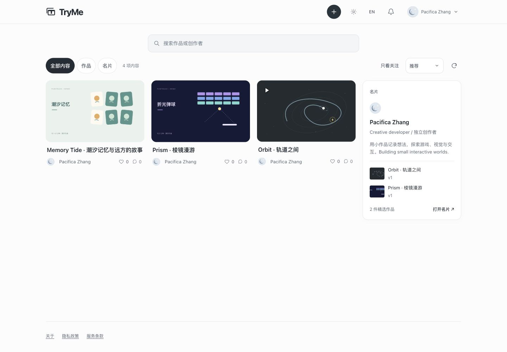
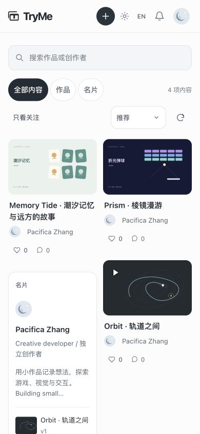
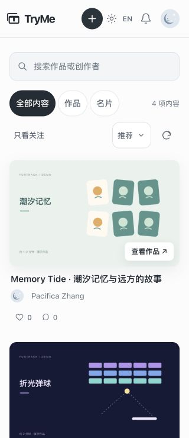

# Frontend hierarchy and copy cleanup — 2026-11-20

Base: `0d933c89b81d42f31afead095cd5c4210b099572` (PR #38). Scope follows the eight-item frontend review. This branch changes presentation and local acceptance tooling; it has not been deployed.

## Result

| Review finding | Implemented behavior |
| --- | --- |
| Inconsistent typography | Work titles and Feed card names use 16px desktop / 15px at ≤720px, weight 600. Authors and secondary controls use 13px; type/category controls 14px; counts 12px. Workspace main headings use 28px desktop / 25px mobile. |
| Hard-clipped author names | Name has its own shrinking span with an ellipsis. At mobile widths, social actions occupy a separate row. Normal `Pacifica Zhang` fits at all three widths; a longer mixed-language name truncates with an ellipsis. |
| Repeated explanation and controls | Search comes first, followed by All content / Works / Cards. Categories appear only for Works. Removed the introduction, per-work type badges, and guest paragraph; kept the sign-in-to-play action on each cover. |
| Preview button anchored to entire tile | Cover link and preview button are siblings in a media wrapper. Title retains its own link. Preview button stays inside the media and is not nested in an anchor. |
| Wrong Cards empty state | Says No public cards yet and offers View all content. Search recovery and load-error retry remain. |
| Fixed count color | Uses the existing `--text-tertiary` theme token. |
| Workspace navigation explanations | Removed the four repeated descriptions, kept navigation labels, enlarged secondary links to 13px, and retained draft/status information. |
| Bilingual footer / obsolete selectors | Footer links follow the selected language. Removed the brand explanation and updated the actual `#site-shell` flex layout. |

The existing monochrome controls, artwork, cover proportions, card templates, colors and masonry layout remain. The default Feed's first cover appears at approximately y=228px on desktop and y=270px on both narrow Chinese layouts, versus approximately 363px / 407px in the reviewed production baseline. Screenshots use synthetic local content rather than a production data snapshot.

## Browser acceptance

Chrome on macOS with viewport overrides: 1440×1000, 390×844, 320×740. These are responsive viewport checks, not physical-device or coarse-pointer Safari acceptance.

- Feed: all 12 width × language (zh/en) × theme (light/dark) combinations. Every measured document width equals the viewport width. Title/author sizes are 16/13 desktop and 15/13 mobile. The 320px English Following / Recommended / Refresh controls stay in one row.
- Workspace: all three widths in Chinese light and English dark. Navigation and published/Feed status remain visible; no horizontal overflow. The 320px navigation uses two columns.
- Work categories appear after selecting Works; switching All content resets category scope. Search with no match retains Clear filters and successfully returns to results.
- Cards-only empty state shows the new copy and View all content returns to the mixed Feed. Footer links follow language and stay at the bottom of a short page.
- Real local sample MP4 playback at 390px: readyState=4, paused=false, currentTime advanced, aria-pressed=true; pause returns aria-pressed=false. URL stays on Feed. No requests that write data occurred during the explicit play/pause interval. This is playback/UI evidence, not automatic recording/provider evidence.
- A long mixed Chinese/English author name has a 134px text slot, 263px content width and computed text-overflow:ellipsis. Avatar and social controls remain separate.
- Public-profile surface (signed-in owner): 390px English dark; title keyboard activation opens the work with the author-page return path.
- White-wall/white-card template: 390px and 320px English dark; title click opens the work with its card context and return path.
- Draft: entered a synthetic website URL, saved and returned, saw the shortened resume prompt, and continued the draft with the URL retained. No publication was submitted.
- Final Feed console inspection returned no errors.

### Main screenshots

[Desktop, Chinese light](frontend-hierarchy-evidence/feed-1440-zh-light.jpg) · [390px, Chinese light](frontend-hierarchy-evidence/feed-390-zh-light.jpg) · [320px, Chinese light](frontend-hierarchy-evidence/feed-320-zh-light.jpg)



| 390px | 320px |
| --- | --- |
|  |  |

[All screenshot and measurement files](frontend-hierarchy-evidence/) include the language/theme matrix, workspace, empty states, long-name and white-card cases. [Preview behavior](frontend-hierarchy-evidence/preview-behavior.json) records playback, geometry and route behavior.

## Reproduce locally

From the repository root with dependencies installed:

```sh
node tests/fixtures/frontend-hierarchy-browser-server.mjs
```

Open `http://127.0.0.1:4964/site.html#/feed`. The fixture uses the actual frontend and HTTP router with synthetic SQLite/in-memory storage. Existing account is the default. Visit `/__workspace?account=guest` for the guest state, or `account=existing` to restore. Visit `/__workspace?cards=empty` to simulate no public cards; use `cards=shown` to restore. Reload Feed after changing a fixture switch.

For playback checks, set `FRONTEND_PREVIEW_MP4` to an existing valid local sample MP4 before starting. `FRONTEND_HIERARCHY_PORT` changes the loopback port. The sample is served only by the fixture, with a synthetic preview pointer in Feed; it does not exercise media storage authorization or video generation. Original screenshots used the existing local video proof-of-concept clip.

## Validation and limits

- `npm run check`: passed (script parsing and TypeScript).
- `npm test`: 723/723 passed; updated the existing mixed-feed test for category visibility and Cards empty-state behavior.
- `npm run build`: passed (Vite/vinext production build; no deployment).
- `git diff --check`: passed.

Not covered by this local acceptance: real mobile Safari/coarse pointer, live authentication, cloud preview generation, staging/production deployment, and the post-publication success page in the browser. The shared work-tile markup was checked on Feed, creator profile and the white-card template; its underlying publication and preview tests pass.
