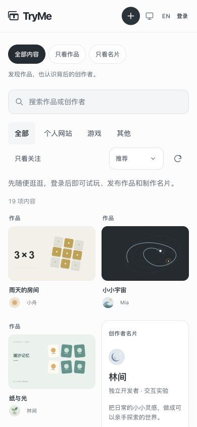

# 名片与作品 Feed 混排 · 本地评审交付

状态：已实现并完成本地验收，未部署、未执行远程迁移。基线 `ae684982ae6a0328f0a7752eee621a3fd6cd79ae`；分支 `feat/card-work-feed-2026-11-20`。此文描述本分支，不表示线上已具备该功能。

## 用户行为

- Feed 默认“全部内容”，提供“只看作品 / 只看名片”。作品继续使用现有 workTile、体验与登录回跳链路；名片标注“创作者名片”，显示作者和所选作品的名称/版本，打开现有 `/c/:id` 公开名片，不创建试玩、点赞或作品曝光事件。
- 作品分类、最多点赞/讨论会进入作品视图；混排支持原作品推荐与最新发布排序。名片按收录顺序排列。两类都有结果时每三件作品插入一张名片，一类耗尽后继续展示另一类。
- 作者从“名片 → 查看名片”的已登录管理页，可明确选择“允许在 Feed 中推荐这张名片”或撤回。冷启动旧 `#/card/:id` 链接仍按现有规则重定向到公开名片；未修改分享路由、账号菜单、工作台或灯城渲染器。

## 数据与权限语义

1. **链接分享不等于 Feed 收录。** `ft_card_feed_selections` 是追加式作者选择记录；没有记录表示未同意收录。现有名片、未来新保存的名片都不会自动获得 Feed 同意，也不会把旧选择迁移到新快照。
2. 每位作者只有其最新选择有效。选择另一张自己的名片替换前一张；`card_id = NULL` 表示撤回。删除当前选中名片后不会回退到历史选择。作者可再次明确选择仍存在的历史名片。
3. `GET/PATCH /api/cards/:id/discovery` 仅允许名片所有者；写入经过现有身份、CSRF、预期账号校验，并使用 `expectedRevision`（该作者最新选择序号）比较后原子追加，防止多个标签页互相覆盖。返回 `listed / eligible / revision`；已选择但其中作品不可发现时 `eligible=false`。
4. 发现中的名片必须未删除、归属与选择作者一致，且快照所有所选作品仍属于该作者、存在、未归档且 `visibility=listed`。隐藏或归档其中任一作品会使整张名片退出发现；恢复满足条件后可重新出现。草稿没有入口。
5. 名片投影复用现有身份逻辑：姓名、头像、简介、短标题在每次读取时来自当前个人资料；所选作品名称、版本和封面引用来自保存快照。作品更新不会改写历史卡。浏览器已显示/缓存的内容不声称通过推送实时更新。
6. 匿名名片 DTO 显式列出展示字段，不包含作者账号 ID、邮箱、作品 URL、metadata/version ID、资源 key、构建 provenance、私有管理状态或点赞身份。公开作品 DTO 保持原有边界。
7. Feed 专用封面 `/api/public/discover/cards/:cardId/works/:workId/cover` 每次重查当前收录和作品可见性，再读取该名片原有封面引用；撤回、删除、隐藏或归档后旧 Feed 封面 URL 返回 404。无法借它访问未选作品或受保护的游戏/HTML。
8. 原 `/c/:id` 分享页及 `/api/public/cards/...` 分享资源保持已有语义：撤回 Feed 或隐藏作品不撤销过去已主动公开的名片链接；删除名片继续由原 tombstone 机制撤销分享。Feed 与链接分享不是同一个授权范围。

## 接口兼容与分页

- `/api/public/discover` 和 `/api/discover` 增加 `type=all|works|cards`。省略 `type` 保持原有作品接口，避免影响作者主页、关联作品和旧调用方；新 Feed 明确传 `type=all`。
- `all/cards` 返回带 `type` 判别字段的 `items`，以及只包含本页作品的 `works`（供现有媒体补全使用）、`total / nextCursor / sort / asOf`。`works` 仍使用原响应结构。
- 混排游标 v2 固定筛选、身份/关注范围、asOf 和 works/events/impressions/credits/card selections 的数据库高水位。内部作品游标和名片选择序号各自前进；游标保留插入节奏，不使用 offset。
- 同一静态结果集，在 limit 1/2/3/4/5/12/48 下遍历顺序一致。新发布作品或重新选择名片进入下一次刷新；可见性仍在每次请求检查，删除/撤回不会使其他内容因 offset 移动而丢失或重复。搜索/关注关系变更属于实时过滤，不承诺保留旧筛选成员；总数随可见性变化。
- 推荐与最新两个混排排序有稳定遍历。最多点赞/讨论继续采用原作品接口及原有限制（取消点赞会改变旧点赞排序）；没有把这个排序包装成新的混排保证。
- 前端去重键是 `work:<id>` / `card:<id>`。名片没有 `data-work-id`，不进入作品曝光、预览或点赞同步。

## 迁移与统一集成

只新增 `drizzle/0023_card_feed_opt_in.sql`，保留所有历史 SQL 和序号；不补不存在的 0020。已更新 `db/schema.ts` 和 `_journal.json` 的追加条目。按照仓库既有手写迁移惯例，不重写旧生成快照。

当前独立部署由 Wrangler 读取 `drizzle/` 顶层 SQL；Drizzle journal 与远端 `d1_migrations` 是不同记录，详见 [独立部署说明](independent-deployment.md)。总验收应按既有备份/迁移程序先应用新增 0023，再部署对应代码。本 session 没有查询或更改远端迁移状态。若回退应用代码，可保留新增选择表，不应删除用户选择记录。

`public/site.js` 接线单独提交，便于与其他 session 合并；只增加 Feed 选项/URL类型参数及已保存名片管理页的独立设置模块挂载，复用现有 route dispose。

## 验证结果与范围

- `npm test`：715/715 通过。
- `npm run check`：通过（应用脚本/内联脚本解析 + TypeScript）。
- `npm run build:standalone`：通过；产物 `dist-standalone/`。存在依赖原有动态 import 提示，无部署。
- `npm run lint`：无法运行，基线没有 ESLint 9 所需的 `eslint.config.*`；未在本功能中改造项目 lint 配置。
- 真实 HTTP router + SQLite SQL/事务、内存 R2 的测试覆盖：旧库增量迁移默认不收录、所有权/CSRF/账号边界、多标签 revision、单作者选择、撤回/删除不回退、隐藏/归档/不存在/外作者作品、专用封面撤权、固定快照与当前身份、匿名字段、筛选/关注、游标误用/损坏、同时间键、分页尺寸、遍历中插入/替换/隐藏、Clerk 边界只放行 GET/HEAD 精确资源路径。
- 前端测试覆盖：类型切换、URL/缓存隔离、同 ID 不同类型、页内/跨页去重、名片不触发作品 social、开关显式写入/双击防护、冲突重读、离开路由后的迟到响应。
- Chrome 本地实际页面：桌面混排、只看名片、名片点击到公开页、返回后类型保留、作品点击后登录页及原回跳参数、加载更多、作者撤回/重新收录均已观察。
- 390×844 浏览器视口：页面 `scrollWidth=390`；全部首屏 tile 坐标在 x=16…374 内；加载更多后 19 条、19 个唯一类型+ID，按钮隐藏。无横向溢出。只是浏览器尺寸模拟，没有 iPhone、Safari、微信或真实 Clerk 登录/生产数据验收。

本地预览（循环地址、自动选择空闲端口）：

```sh
node diagnostics/mixed-feed-preview.mjs
```

`/__qa/guest` 为匿名 Feed；`/__qa/owner` 为合成作者的名片工作区，点击“查看名片”进入收录开关；`/__qa` 为 390px iframe。服务使用本分支真实前端和 router，数据与身份为合成 fixture，不连接云服务。

## 截图

[桌面混排](evidence/mixed-feed-2026-11-20/desktop-mixed.jpg) · [只看名片](evidence/mixed-feed-2026-11-20/cards-only.jpg) · [公开名片落点](evidence/mixed-feed-2026-11-20/public-card-destination.jpg) · [作品登录链路](evidence/mixed-feed-2026-11-20/work-login-gate.jpg) · [作者关闭](evidence/mixed-feed-2026-11-20/owner-opt-in-off.jpg) · [作者收录](evidence/mixed-feed-2026-11-20/owner-opt-in-on.jpg)


