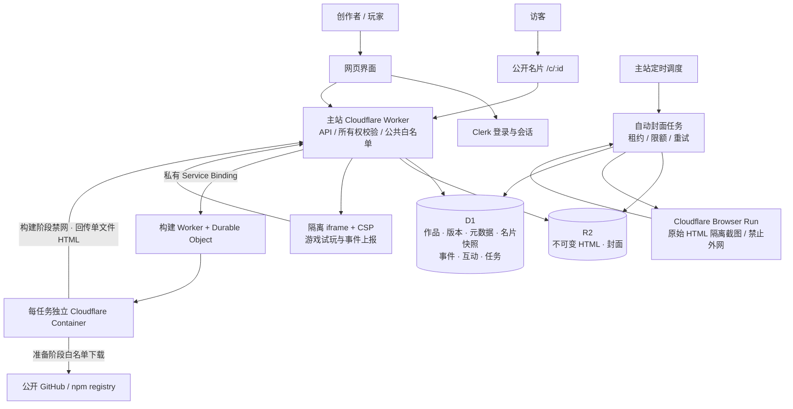

# Funtrack · 产品现状与系统架构

> 历史快照：当前部署、功能边界及待办请看 [2026-11-19 项目现状](project-status-2026-11-19.md) 与 [系统架构](system-architecture-2026-11-19.md)。下文保留当时事实，不作为实时状态。

核对日期：2026-11-17。两条自动封面云端链路、验收作品归档及历史数据保留已核对；GitHub Actions 首次运行已通过。

Funtrack 已从脑爆和 HTML 原型进入**可邀请外部用户体验的云端测试版**：创作者发布小游戏，玩家在网页中试玩和互动，创作者查看数据，并用自己的作品制作可分享名片。网站、数据、文件与 GitHub 构建器都已部署在 Cloudflare，正常使用不依赖开发者电脑开机。

- [打开测试站](https://funtrack-staging.zhayizha-pacificapie.workers.dev/site)
- [协作源码（私有仓库，需邀请/授权；尚未确认合作者已获访问权）](https://github.com/PacificaPie/funtrack)
- [开发交接与本地启动](https://github.com/PacificaPie/funtrack/blob/main/docs/collaboration-handoff.md)

当前仍是 `workers.dev` 临时域名 + Clerk development 登录实例；正式域名、正式登录实例和账号迁移尚未完成。这里的“可测试”不等于已完成正式生产验收，也不等于已经证明用户留存、推荐效果或商业模式。

## 产品说明

**要解决的问题：** 小游戏做出来后缺少被看到、被试玩和得到具体反馈的机会；创作者也缺少能集中呈现真实作品的作品集入口。

**当前用户：** 做网页小游戏的创作者，以及愿意试玩、点赞和提出建议的人。互玩机制让创作者也能为他人的作品带来第一批反馈；它不保证每件作品一定得到固定数量的曝光。

**当前产品边界：** 网页平台优先。以静态网页小游戏为主，支持自包含 HTML 和有明确边界的公开 Vite 仓库构建；不托管游戏后端。共创权限、收费、会员、小程序与微信登录尚未实现。旧讨论稿的“前 100 次真实游玩”“30 秒有效游玩”“积分账本”和 MCP/GEO 规划仍是历史提案，不能当成当前已上线承诺。

### 核心动线

| 使用场景 | 当前流程 | 关键边界 |
| --- | --- | --- |
| 发现与试玩 | 登录 → Feed 推荐/最新 → 作品详情 → 试玩/全屏 → 点赞、评论或反馈 → 返回 Feed | 主 Feed 当前需登录；外链作品只能测入口/出站数据 |
| 发布 | 登录 → 选择本地 HTML、已部署链接或 GitHub 导入 → 校验/构建 → 预览 → 发布 | 新作直接进 Feed，人工收录确认已取消；失败不生成假成功作品 |
| 持续迭代 | 创作中心 → 编辑名称/说明/封面，或上传新版本 → 预览 → 更新；需要时回滚 | 作品链接稳定，旧版本、旧名片和历史数据保留 |
| 管理作品 | 默认看活跃作品 → 隐藏 Feed 或归档 → 归档列表恢复 | 隐藏与归档是两种状态；恢复归档后仍隐藏，需要明确重新展示 |
| 制作名片 | 选择 1–30 件作品 → 选择模板 → 真实作品预览 → 保存 → 分享 | 保存为不可变快照；以后改作品或生成新卡，不改旧卡 |
| 分享名片 | 收到 `/c/<名片ID>` 链接 → 免登录看名片/封面/展厅 → 试玩时登录 → 回到该卡固定的作品版本 | 只开放名片阅读；没有匿名试玩、匿名账号或匿名统计 |
| 查看数据 | 创作中心 → 全部作品/单作品 → 时间范围、日/周粒度与版本筛选 | 可只看外部访客；没有记录的时长/外链游戏指标显示未知 |

### 已实现功能与验收边界

| 模块 | 已有能力 | 尚不能据此声称 |
| --- | --- | --- |
| Feed 与推荐 | 瀑布流、推荐/最新/点赞/讨论排序；曝光埋点；新作基础优先；试玩后互动给作者自己的作品少量加权 | 不是兴趣个性化模型，未证明提升留存；单账号去重不等于解决多账号互刷 |
| 上传与云构建 | 本地 HTML、版本更新和 GitHub HTML 直读统一 8 MiB；公开 Vite 仓库云构建已真实跑通导入、预览、发布和试玩 | 不支持任意仓库、后端服务、私有依赖或 ZIP 直接运行 |
| 版本与归档 | 同作者内容去重、版本更新/回滚、信息编辑、Feed 隐藏、可恢复归档 | 归档不是删除；归档后的老名片、历史版本和直链仍保留 |
| 创作者数据 | PV/UV、Feed 曝光/触达、打开/开始/独立试玩账号、上报完成、有效前台时长样本、互动与出站点击；聚合、趋势和作品比较 | 客户端上报不能证明真人/通关；外链不推断时长；不是次日留存或因果归因系统 |
| 名片 | 白墙画展、卡中展厅、点亮收藏、作品手记、放映册共 5 种模板；旧快照固定；匿名分享与登录回跳已实测 | 名片生成没有调用 AI 模型，也没有付费计费 |
| 界面 | 中英界面，浅/深/系统主题，hover/焦点/减少动效，加载重试，手机布局、全屏、零作品和归档空态 | 360px 浏览器检查不是全机型真机覆盖；用户作品文案不自动翻译 |
| 自动封面 | 已有 Snake 手动生成、新上传无封面的 Prism 自动生成均在真实云端 ready，浏览器实际显示图片；只截开屏，不代玩；保留手动上传 | 不识别“这是否是游戏”，不保证截图美观；运行时长记录不是账单验收，失败不阻断作品发布 |
| 协作 | 私有 GitHub 仓库、交接文档、分支/PR 约定；首次 CI 检查、测试与构建已通过 | CI 不做部署/迁移 |

推荐目前是可检查的规则实验 `reciprocity-v1`：新鲜度最多 400 分、新作初始最多 200 分、近期独立外部试玩最多 200 分、作者贡献最多 40 分。贡献需要先试玩，再于 24 小时内点赞、根评论或反馈；同账号同作品最多一次，同目标作者每天最多一次，每天最多三次。新作无需先互动就有基础优先。规则详情见[推荐验收](https://github.com/PacificaPie/funtrack/blob/main/docs/recommendation-experiment-2026-11-16.md)。

## 系统架构

**四个重要边界：**

1. 登录/创作 API 由 Clerk 会话和所有权约束；公开分享只允许指定名片与其快照封面的只读访问，不公开作者后台、私有列表或游戏文件。
2. 作品是稳定 ID，版本、元数据和保存的名片是历史快照。更新、回滚、手动封面和归档都不能改写已保存的名片。
3. 不可信游戏在隔离 iframe 中运行；可信 3D 展厅只使用作品资料和封面。仓库构建在独立容器，准备阶段有限出网，执行 build 时禁网。
4. 自动封面读取平台已有 R2 HTML，不接任意 URL、不带用户登录信息、不创建试玩会话/事件；条件更新防止迟到截图覆盖手动封面或新版本。

## 技术栈

| 层 | 当前使用 | 主要代码依据 |
| --- | --- | --- |
| 产品界面 | HTML/CSS、JavaScript ES modules，语义主题变量与中英字典；3D 展厅使用本地 Three.js | `public/site.*`、`discovery.js`、`analytics.js`、`theme.*`、`gallery/` |
| 框架与构建 | TypeScript、Vite、vinext（承接 Next 风格路由），Cloudflare Vite plugin | `vite.config.ts`、`app/`、`scripts/standalone*` |
| 服务端 | Cloudflare Workers，业务规则按模块组织 | `worker/standalone.ts`、`lib/funtrack/` |
| 身份 | Clerk 前端登录与后端 session 验证 | `public/auth-*`、`standalone-auth.mjs` |
| 数据与文件 | Cloudflare D1（SQLite 语义）、R2；Drizzle schema + 追加 SQL migration | `db/schema.ts`、`drizzle/` |
| 仓库构建 | Workers 私有 service binding、Durable Objects、Containers、Node/npm 固定工具链 | `cloud-builder/`、`build-service.ts`、`repo-builder.mjs` |
| 自动封面 | Browser Run、`@cloudflare/puppeteer`，D1 队列/租约、Cron | `auto-cover-service.mjs`、`auto-cover-capture.mjs` |
| 检查与协作 | Node.js 22+、`node:test`、SQLite/Miniflare 集成检查、TypeScript、GitHub Actions | `tests/`、`.github/workflows/ci.yml` |

仓库含 Next/React 及 UI 库依赖，但当前主要用户页面是 `public/` 下的 HTML/CSS/JS，并非已经整体改造成 React 页面。最初方案中的 Postgres、Redis、ClickHouse、事件流处理和 MCP Server 不是当前生产架构。

## 当前状态与下一步

### 版本与数据状态

| 项目 | 核对结果 |
| --- | --- |
| 产品阶段 | 云端测试版；正式域名和 Clerk production 尚未配置 |
| 应用代码基线 | 私有仓库已推送，`b7adba1`；后续仅文档提交不改变本次已部署应用代码 |
| 本地自动检查 | 359 项测试通过；脚本/类型检查、standalone 构建与预检已由部署记录确认 |
| 本轮 Cloudflare 主站 | `13c9a469-8b3d-4d3d-beda-526de43cb10c`；两条自动封面真实云端链路已通过 |
| 公开分享与归档 | 已上线，匿名名片/3D 展厅/登录回固定 v1、归档恢复、重复上传引导等已有实测 |
| GitHub CI | `b7adba1` 的首次 [Actions 运行 44028978849](https://github.com/PacificaPie/funtrack/actions/runs/44028978849) 成功；只执行检查/测试/本地目标构建 |
| 历史数据保留 | 本轮完成后为 13 件作品、16 个版本、3 张名片，7 件已归档、6 件 Feed 展示；当前验收作者默认显示 5 件活跃作品。全部 3 张旧名片 snapshot SHA-256 与本轮前基线完全一致 |
| 自动封面验收 | Snake 已有作品主动生成、Prism 无封面 HTML 发布后自动生成，各仅 1 次尝试；记录耗时分别 3488ms / 1710ms；都生成新 metadata revision 2，原版本 ID 不变 |
| 截图与数据口径 | 基线 32 个试玩会话与全部 6 类事件计数完全未增加；截图没有产生试玩统计。Cloudflare 官方会话历史确认两次均为 NormalClosure 正常关闭，provider 时长分别 1973ms / 991ms，之后活动会话为 0；这与平台完整任务耗时口径不同，实际账号总账单未验收 |
| 本轮新增测试 | 新增 1 件自动封面验收作品 Prism，已通过真实 UI 归档至 revision 3；没有永久删除它的版本、文件或历史数据 |

这些数量用于验收数据保留，不是正式用户规模或产品增长指标。零上传页面使用真实页面渲染函数配合隔离 fixture，并已在 360px 深色布局核对；本轮没有把它冒称为重新注册真实云端新用户的验证。

测试站数据在云端 D1/R2，换域名本身不会清空数据；但正式环境应独立规划迁移。Clerk development/production 身份可能变化，当前尚无跨实例账号映射，必须先处理身份关联，再迁移作品归属和文件，保留旧链接。详见[独立部署说明](https://github.com/PacificaPie/funtrack/blob/main/docs/independent-deployment.md)。

### 下一步与建议分工

以下是建议，不代表已分配责任人或承诺上线日期。

| 优先级 | 建议协作范围 | 明天可交付的结果 |
| --- | --- | --- |
| 1 | 一人扮演新创作者，另一人扮演收到分享的玩家 | 用各自真实新账号完成登录 → 上传 → 试玩 → 更新/回滚 → 名片分享；退出登录打开名片，再登录检查固定版本；逐条记录成功/失败与浏览器 |
| 1 | 前端体验与测试整理 | 复核空账户、全归档账户、手机/键盘、返回位置；集中观察名片展厅首次加载偶发超时，不通过增加提示文字掩盖问题 |
| 1 | 后端/数据维护 | 观察自动封面失败率、耗时、任务关闭与预算；确认手动封面、旧版本/卡片和统计不受影响；只归档验收作品 |
| 2 | 产品与推荐复盘 | 收集“能否发现想玩的作品、反馈有没有用、名片是否愿意分享”的实际案例；区分流程可用和推荐有效，不先优化虚构大规模指标 |
| 2 | 正式部署准备 | 选域名，规划 Clerk production 与账号映射，演练 D1/R2 迁移、旧链接与恢复；完成后再决定切正式环境 |
| 暂缓 | 新身份/商业化/新载体 | 微信登录只有[可行性研究](https://github.com/PacificaPie/funtrack/blob/main/docs/wechat-login-feasibility-2026-11-17.md)；共创、收费、小程序和匿名试玩另行确定范围 |

### 核对来源

- [界面、归档与公开名片验收](https://github.com/PacificaPie/funtrack/blob/main/docs/interface-validation-2026-11-17.md)
- [云端公开仓库构建验收](https://github.com/PacificaPie/funtrack/blob/main/docs/cloud-builder-deployment-2026-11-16.md)
- [数据统计口径](https://github.com/PacificaPie/funtrack/blob/main/docs/analytics-contract.md)
- [自动封面实现与验收边界](https://github.com/PacificaPie/funtrack/blob/main/docs/automatic-covers-2026-11-17.md)

---

## Notion 同步

本文已同步至既有项目下的 [Funtrack · 产品现状与系统架构](https://app.notion.com/p/41bed61b626d817cade2d4a052449b81)。[项目主页](https://app.notion.com/p/41aed61b626d815ea0e4d070bd939f2b) 顶部增加日期明确的现状入口，2026-11-13 原始脑爆完整保留并标明历史范围。档案的阶段、最近核对、展示/来源、文档指向和下一步已更新；个人贡献与简历用途未改。
