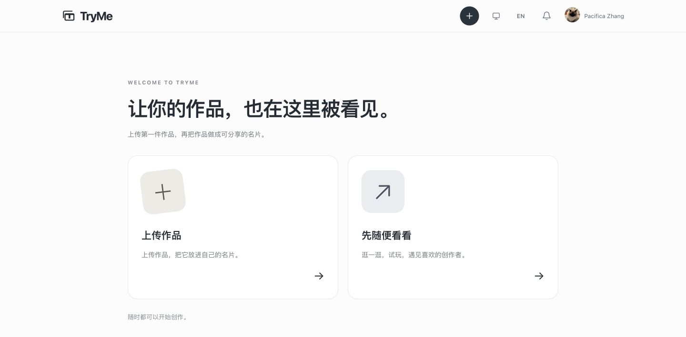

# 2026-11-19 · 导入、可选引导与私有媒体恢复发布

用户在核对待合并清单后授权推进 #30、#34、#29 及 #32 文档。功能 PR 已合并并部署到 [trymecard.com](https://trymecard.com)。本次保留已上线的 #33 开场节奏/翻面和 #35 鼠标锁定，不合入微信、AI 实验、旧综合草稿或本地城市名片改版。

## 发布内容与版本

| 项目 | 结果 |
| --- | --- |
| [#30](https://github.com/PacificaPie/tryme/pull/30) | Three.js 动态通用加载器不再被误当作缺失外部资源；主站与构建器镜像同步更新。合并 `9033d05` |
| [#34](https://github.com/PacificaPie/tryme/pull/34) | 新账号直接进入 Feed，可关闭上传邀请；创作时再填写昵称并进入上传向导。合并 `bad305f` |
| [#29](https://github.com/PacificaPie/tryme/pull/29) | 同内容文件重选保留私有草稿/媒体选择；已获准捕获在请求中断后获得有界存活时间。合并 `838b149` |
| 准确应用发布提交 | `838b1498c98fa38e1ded2047f83b1ab7b0715e81` |
| Production 主站 | `07d692a2-b60f-4c67-9e20-6529d7e60ac5`，100%；2026-11-19 15:28:11 EST |
| Production 构建器 | `3e4a9a44-34b8-4172-bc65-08d9da0f9221` |
| 容器镜像 | `sha256:b888e3c7dc7214edf40ebf714698ff4b821bce073b65366cd2805d101840bc91`；实际 production 应用配置已回读，default scheduling，2 个 healthy、0 starting、无错误 |
| Staging 主站 / 构建器 | `28e235ee-e543-4463-a255-12e2401008ed` / `c53c6311-dbd6-4889-bf91-2d237c20d296` |
| 发布前生产版本 | 主站 `80097e75-3e0c-4b60-ae44-6a51f2953a62`；构建器 `a553bbf8-20b7-4156-b01e-4725bd656f95` |

合并前在独立工作区试合并四个 PR 并逐项审阅；未解决 review threads 为零。集成与 main 的非文档内容一致。主站从准确合并提交按显式 production 配置重新构建；两套配置均 dry-run 确认目标资源。没有迁移、secret 轮换或身份配置更改。保留远端 Clerk 和 runner secrets；未把本地缺少 secret 的离线预检写成通过。

## 自动检查与真实 staging 验收

- `npm run check`、700/700 应用测试、6/6 runner 测试通过；staging/production standalone 构建及两个构建器 dry-run 通过。
- 准确 main 提交的 [GitHub Actions 44608740000](https://github.com/PacificaPie/tryme/actions/runs/44608740000) success。先前两次 main CI 因连续合并被后续运行取消，不作为独立通过记录。
- 使用 [Clerk 官方保留测试邮箱流程](https://clerk.com/docs/guides/development/testing/test-emails-and-phones)，新 development 账号完成真实登录后直接进入 Feed；关闭邀请后刷新仍不显示；进入创作、保存昵称后到达真实上传向导。不是本地 mock 身份，也不是 production 邮件送达测试。
- `123bingowinnn/forgetax` 已从最初复现的 `5b619d9` 更新为 `a14718de08ff7b14073d06cfbacfceb6fea9ec83`。新提交的 GitHub blob 直读通过；实际 Cloudflare Containers 仓库构建任务 `3fb9e607-689d-4384-9a40-7e85e4c6e6d3` 为 ready，1,186,028 bytes，SHA-256 `2eb56f85776c5688f87af6241ae4bdc3a0bbbcbf30f01350a5c8866ccaf992ba`，未运行项目脚本或安装项目依赖。Chrome 打开真实产物并进入教程第 1 步。
- 容器部署返回成功后，应用镜像仍有短暂滚动切换期。staging 第一项任务在此期间报 `EXTERNAL_ASSET`；相同文件在新镜像中本地检查通过，待应用镜像就绪后新任务通过。production 同样观察到配置暂时指向旧镜像，随后回读为新摘要且全部 healthy，再执行导入验收。不能将 deploy 命令完成视为容器镜像已全部生效。
- 原创 HTML 私有草稿 `6dc2f898-d5c1-4c7a-9bbb-47d319053129`：在 D1 与 UI 观察到捕获进行中后离开上传页，使页面请求取消；云端原记录随后 ready。返回恢复封面及 7.957 秒 MP4，再选择两项并换用字节相同、文件名不同的 HTML，仍保留原草稿与两项选择。
- 最终 D1 只有一个相同内容草稿、一项封面 capture（`cfd82dae-7d3e-4892-82ab-3d66225a62f5`，28,671 bytes）及一项 video capture（`5386b55e-c014-4db3-ad64-0d73929523ce`，203,433 bytes）。匿名读取媒体 401。没有发布测试作品。

这一断连案例证实恢复路径可用，不能证明任意时间的任务都能完成；`waitUntil` 仍受提供方的断连后时限约束。游戏只验证导入和启动，不是全流程玩法验收。

## Production 验收

- 8 项关键 HTML/JS/CSS 与发布源码 SHA-256 一致，包含 onboarding、publish-media、opening 和 versioning；公开 discover 为 200，匿名 me/works 为 401，认证仍是 Clerk production。
- 现有真实登录会话打开新版可选引导，点击「先随便看看」进入 Feed，上传入口可用。
- 发布前后 7 件作品、7 个版本、12 条 metadata、6 张名片及 22 条迁移账按全部所读字段逐行一致；没有重写作品或名片快照。
- Production 云构建任务 `5c143702-a5e4-4693-a663-b4a4ac7863bc` 为 ready，固定 `a14718de08ff7b14073d06cfbacfceb6fea9ec83`，产物 1,186,028 bytes / SHA-256 `2eb56f85776c5688f87af6241ae4bdc3a0bbbcbf30f01350a5c8866ccaf992ba`，与 staging 一致。实际已登录 Chrome 打开生产私有预览并进入教程第 1 步。随后回到 Feed，没有发布成公共作品；回读活动构建任务为零，原业务数据再次核对不变。

构建 metadata 的 `execution.worker` 沿用旧代码硬编码的 `funtrack-builder-staging` 标签，不能用该字符串判断实际环境。本次 production 结论依据正式域名、production D1 任务、显式 production service binding 与实际容器应用回读；标签修正不混入本次发布。

机器记录：[生产资源与 API](evidence/release-2026-11-19/production-smoke.json)、[生产云构建](evidence/release-2026-11-19/production-build.json)、[原业务数据完整性](evidence/release-2026-11-19/production-integrity.json)、[断连恢复与同文件重选](evidence/release-2026-11-19/staging-resume.json)。完整原始日志和只读基线保存在发布工作区 `.preview/release-2026-11-19/`，不把原始业务行提交到仓库。

## 回退与剩余边界

没有 schema 变化。必要时可回退主站到上述前一版本，或回退构建器到前一 Worker/镜像组合；构建器回退前先检查并等待活动任务结束。主站回退后浏览器邀请关闭 key 不产生作用。同文件恢复和 Three.js 兼容修复会随回退失效。

未新增手机硬件、Safari/微信内置浏览器、完整游戏或生产新注册账号验收。#22/#1 微信、#23 AI 实验、#10 旧综合方案仍独立保留；本次未执行 AI 调用、付费试点或微信配置。
