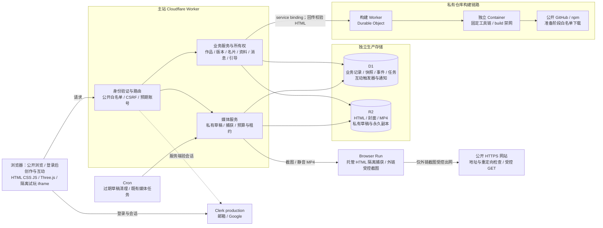
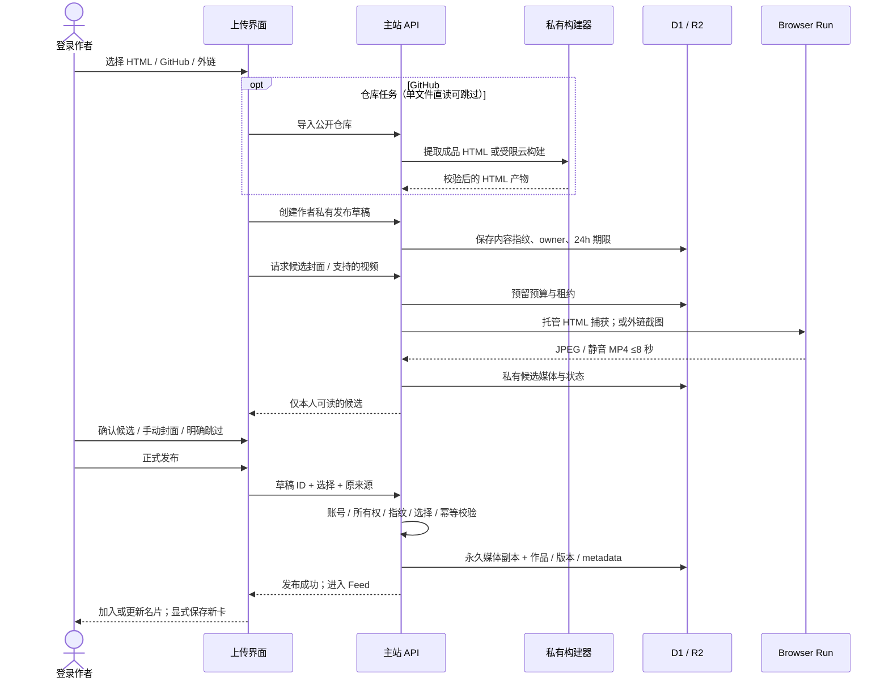
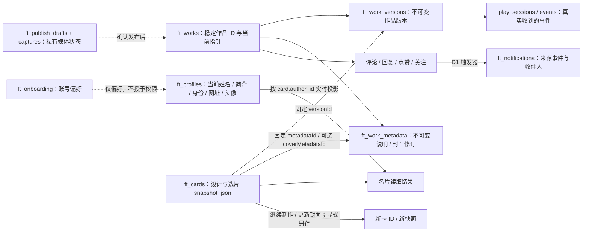

# TryMe · 当前系统架构

基线：2026-11-19 应用发布提交 `838b149`，已包含 #29/#30/#34，保留 #33/#35。生产版本、证据与待办见 [项目现状](project-status-2026-11-19.md)。以下画的是当前独立 Cloudflare 站点；未合并的微信和 AI 实验不属于生产依赖。

## 1. 系统总览

**读取与权限。** 游客只读公开发现、指定名片及允许的媒体；游戏文件、私有草稿、发布、事件与后台 API 仍鉴权。公开页面不创建匿名试玩会话或匿名互动事件。预期账号 header 只是与已认证身份比较，不能充当身份来源；旧客户端未携带 header 的兼容行为仍保留。

**构建与捕获分开。** 构建器只经私有 service binding 访问，由 Durable Object 调度容器，产物经主站验证；截图/录像使用 Browser Run，不执行 npm 构建。托管 HTML 捕获禁止外网；外链截图经受控 GET/资源代理和地址检查，不携带用户登录会话。不能再概括为“所有截图都禁止外网”或“外链不截图”。

**不虚增统计。** 捕获读取原始 HTML，不建立玩家会话；Feed 视频预览不等于试玩。现在的录制是固定规则/已验证内容脚本，不是生产 AI agent。

## 2. 首次发布的私有到公开流程

此图是首次发布；已有作品的版本更新、补封面和重录仍有各自入口。候选失败可以重试、手动上传封面或明确跳过，不能默认替作者确认。外链无自动视频。已经选用的视频不再次排队生成；Cron 清理过期草稿时不删除已发布副本。D1 与 R2 不是一个跨存储事务，依靠幂等、归属校验与清理处理失败。

## 3. 数据权威源与名片快照

这是逻辑引用图，不声称所有箭头都是数据库外键。**作品与名片不是全部字段都实时，也不是全部字段都冻结。** 作品 ID 稳定，旧版本与 metadata 保留；名片设计、签名、选片、作品版本及封面引用固定。个人身份通过 `ft_cards.author_id → ft_profiles.id` 实时投影。显式更新封面生成新卡，`coverMetadataId` 只选图片，不悄悄更新原说明；旧卡链接和 JSON 不变。做同款不复制原作者身份或作品。

评论保存发表时页面版本，历史未知不回填；它不是试玩证明。通知由互动表触发器产生，按收件人读取/已读，不给自己发提醒、不回填旧事件。新用户直接浏览 Feed，邀请的关闭按账号保存在当前浏览器，不要求服务端写入；创作者昵称及既有偏好/完成状态仍由服务端保存，不改变权限。

## 技术与代码入口

| 范围 | 当前实现 / 主要文件 |
| --- | --- |
| 产品页面 | `public/site.*`、`discovery.js`、`onboarding.js`、`opening.js`；HTML/CSS/ES modules，Three.js 模板；不是整站 React 重写 |
| 框架/部署 | TypeScript、Vite、vinext；`worker/standalone.ts`、`standalone-auth.mjs`、`wrangler.standalone.production.jsonc` |
| 发布与媒体 | `publish-draft-service.mjs`、`media-budget.mjs`、`auto-cover-*`、`external-cover-*`、`video-preview-*` |
| 身份、作品与名片 | `server.ts`、`rules.mjs`、`card-identity.mjs`、`card-cover-service.mjs`、`public-sharing.mjs`、`public/card-export.js` |
| 通知与引导 | `notification-service.mjs`、`onboarding-service.mjs`、`public/notification-state.js`；迁移 `0021` / `0022` |
| 存储 | Cloudflare D1（SQLite）、R2；`db/schema.ts`、`drizzle/`，迁移只追加 |
| 仓库构建 | `cloud-builder/`、`build-service.ts`、`scripts/repo-builder.mjs`；Container、Durable Object、私有 binding |
| CI | `.github/workflows/ci.yml`：检查、Node 测试、本地目标构建；不自动迁移或部署 |

`lib/funtrack/` 下的文件在表中省略公共前缀。生产和 staging 使用独立 Worker、D1、R2、Clerk 实例与配置；旧测试账号/作品没有因此自动迁入生产。当前没有 Postgres、Redis、ClickHouse、Kafka、MCP Server、生产微信认证或生产 AI 探索服务。

## 可维护文件

本页三段 Mermaid 是权威图源，独立 `.mmd` 和渲染 SVG 放在 [diagrams/](diagrams/README.md)；[离线三图查看器](diagrams/architecture-viewer.html) 可切换查看。更新图时先核对 Worker 入口、公开权限、草稿发布服务、card identity 与新迁移，再同步 Notion。历史发布记录保留当时结果，不在旧日期下覆盖成新版本。
