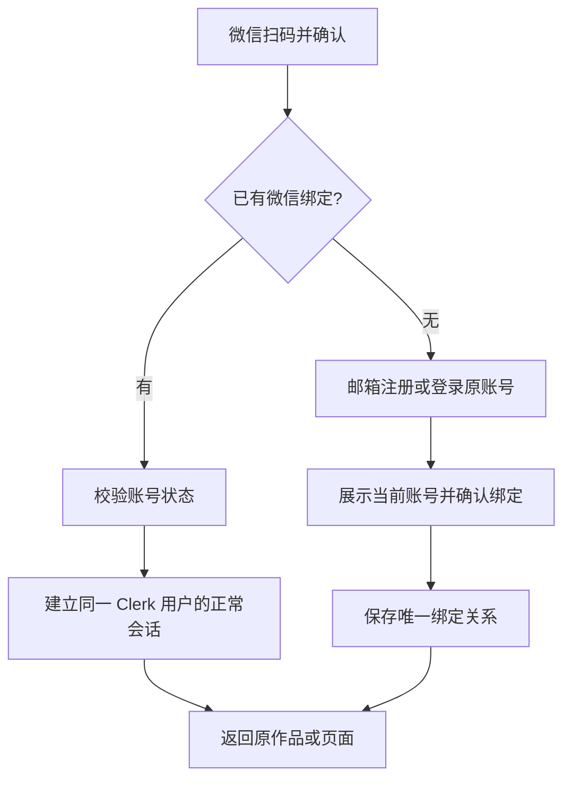

# 微信扫码登录与邮箱绑定

更新日期：2026-11-17。实现位于 `feat/wechat-email-login`。这是接入准备，不代表微信网站应用已获批或真实扫码已验收。默认配置关闭微信入口，现有 Clerk 登录继续工作。

## 本轮范围

- 电脑端使用微信开放平台的网站应用扫码授权；后端交换授权码，不在前端接触 AppSecret 或微信 access token。
- 首次微信授权后进入正常 Clerk 注册/登录，验证邮箱，再明确确认将微信关联到当前账号。
- 已有 Funtrack 用户从账号设置绑定微信。后续微信登录指向同一个 Clerk user ID，作品、版本、名片与统计的作者 ID 不迁移。
- 新登录方式绑定要求最近 5 分钟内完成适用的身份验证；更旧的会话需重新登录验证。账号切换、跨标签页流程覆盖和绑定冲突会拒绝提交。
- 已绑定用户可用微信换取一次短期 Clerk 登录票据。开启 MFA 的用户本版回到正常 Clerk 登录完成验证；不绕过二次验证或未完成的会话任务。
- 邮箱是本版唯一的联系方式前提。手机号、微信内 H5 授权、小程序、解绑/更换微信和跨 Clerk 实例迁移不包含在本版。

## 用户路径

微信尚未配置时不显示扫码按钮；直接访问未启用的微信接口会失败，不产生模拟登录。绑定过程中不会根据昵称、客户端填写的邮箱或 UnionID 自动合并账号。

## 代码与数据

| 范围 | 位置 | 职责 |
| --- | --- | --- |
| 身份边界 | `lib/funtrack/standalone-auth.mjs` | 公共 OAuth 路由白名单；账号接口继续由真实 Clerk 会话、已验证邮箱和近期验证约束 |
| 微信服务 | `lib/funtrack/wechat-auth.mjs` | 官方授权地址、state/浏览器证明、回调、待绑定状态、唯一映射、票据兑换 |
| 前端 | `public/auth/`、`public/auth-client.js` | 受控扫码入口、首次邮箱流程、确认、取消、重试、账号设置与登录回跳 |
| 追加迁移 | `drizzle/0013_wechat_identities.sql` | 微信身份映射、短期事务和请求限流；不修改旧业务记录 |
| 发布检查 | `scripts/standalone-config.mjs` | 启用时检查 AppID 与秘密绑定声明；禁止将 AppSecret 放进 `vars` |

映射以 `(app_id, open_id)` 唯一，并限制一个 Clerk 用户在同一网站应用下只绑定一个微信。UnionID 只保留作后续明确迁移的参考，不用于自动归并。微信事务只保存随机 state/浏览器证明/完成凭据的散列，凭据本身在短时 HttpOnly、Secure、SameSite=Lax cookie 中；`flowId` 只是标签页相关性 ID，不是登录凭据。

公开端点只负责 OAuth 事务；`/api/account/wechat/*` 仍走现有账号鉴权。回调消费和票据兑换是一次性操作。票据有效期设为 60 秒，不写 URL、localStorage 或日志；签发前重新读取 Clerk 用户状态，停用、锁定或没有已验证邮箱的账号不能获得票据。

本次使用 `0013` 是为了给另一轮独立的名片删除变更保留 `0012`。合并时复核迁移目录及 Drizzle journal，同时保留两项追加迁移；不要改写已上线迁移或重置数据库。

## 启用前需要完成

2026-11-17 待办（用户明确暂缓，待与组员讨论）：

- [ ] 确定微信开放平台申请主体与正式域名；目前均未定，不代为提交申请或开启入口。
- [ ] 讨论完成后再申请网站应用、配置授权回调与密钥，并完成下述真实扫码验收。

1. 确定自有域名及申请主体，准备可审阅的网站介绍、协议和联系方式等材料；以微信开放平台实际审核要求为准。
2. 创建并获批“网站应用”及微信登录权限，配置授权回调域。回调地址固定为 `https://<APP_ORIGIN 主机>/api/auth/wechat/callback`。
3. 配好相应域名上的 Clerk 实例。正式实例迁移需要单独处理已有账号映射；微信接入不会自动搬迁 development 用户。
4. 在目标配置中填写公开 `WECHAT_APP_ID`，将 `WECHAT_APP_SECRET` 声明为所需 Worker secret，并通过 Wrangler 的秘密输入通道设置。密钥不进聊天、Git、浏览器 URL、日志或静态页面；仅后端按微信官方协议在固定 HTTPS token 接口请求中传递。
5. 先应用追加迁移，执行检查/测试/standalone 构建和目标环境预检，再启用 `WECHAT_LOGIN_ENABLED="1"` 并部署。实际域名、微信应用和 Clerk 实例必须匹配。

当前两个配置模板保持 `WECHAT_LOGIN_ENABLED="0"`。关闭功能可停止新扫码与绑定；已有邮箱登录和作品归属不受影响。D1 中的绑定记录无需为关闭开关而删除。

## 验收口径

自动化检查覆盖 OAuth 回调、重放、过期、并发、近期验证、身份冲突、账号状态、输入限制和旧业务数据保留；前端隔离 fixture 用真实页面控制器验证交互，但它们不能证明真实微信授权成功。

本轮本地 `npm run check`、全部 **390 项测试** 与 `npm run build:standalone` 通过，新页面与模块已进入构建产物。独立工作目录的本地 D1 迁移也通过，未修改远程数据库。后端针对性回归使用真实 SQLite 迁移和事务、注入微信/Clerk 网络边界；鉴权测试另使用真实 Clerk SDK 验证本地签名 JWT 与 factor-verification-age。独立复核修复了旧响应覆盖新流程 cookie、Clerk 错误状态被当成匿名、返回路径规范化和浏览器证明过早过期四项问题。

浏览器隔离验收已检查：未启用时无微信按钮；开启后的上游失败仍保留邮箱入口；首次邮箱完成后还需明确确认；确认成功/取消都回原路径；过期、绑定冲突、账号不匹配、重新登录验证和 MFA 回退有对应操作；360px 英文深色确认页无横向溢出。fixture 的邮箱步骤明确标注为模拟，不发邮件，也不产生真实微信绑定。截图保存在忽略目录 `.preview/wechat-review/`。

真实启用后必须另做：PC 手机扫码确认、拒绝授权/二维码过期、首次邮箱注册、旧邮箱账号绑定、微信再次登录、切换账号冲突、MFA 回退、原作品/旧名片归属与分享登录回跳。未取得微信应用和域名前，不将这组结果记为通过。

## 官方依据

- [微信网站扫码登录](https://developers.weixin.qq.com/doc/oplatform/Website_App/WeChat_Login/Wechat_Login.html)
- [微信身份字段与 UnionID](https://developers.weixin.qq.com/doc/oplatform/Website_App/WeChat_Login/Authorized_Interface_Calling_UnionID.html)
- [Clerk 登录票据](https://clerk.com/docs/reference/backend/sign-in-tokens/create-sign-in-token)
- [Clerk 票据与 MFA / session tasks 的边界](https://clerk.com/docs/guides/development/testing/test-against-production)
- [Clerk 敏感操作重新验证](https://clerk.com/docs/guides/secure/reverification)
